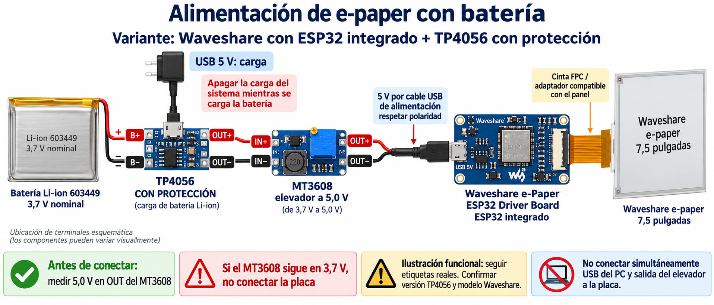

# ESP32 e-Paper Dashboard

Dashboard personal de 800 x 480 para Waveshare e-Paper de 7,5 pulgadas y **e-Paper ESP32 Driver Board Rev. 3 con ESP32 integrado**. Muestra meteorologia, calidad del aire, calendario, tareas, nota manual y contador de mensajes sin leer de Gmail.



Esquema funcional para un TP4056 con proteccion. La posicion ilustrada de los terminales es orientativa; consulta [las conexiones y comprobaciones de alimentacion](docs/alimentacion.md) antes de montar el circuito.

## Estructura

- `src/`: firmware y recursos del dashboard.
- `config/`: plantillas sin credenciales reales.
- `examples/pantalla/`: un refresco con texto y figuras para la placa integrada.
- `examples/solo_esp32/`: prueba por puerto serie, sin pantalla ni Wi-Fi.
- `examples/legacy_esp32_hat/`: montaje anterior con ESP32 separado y HAT; sus GPIO son distintos.
- `google_apps_script/`: servicio de Google y pruebas con servicios simulados.
- `docs/`: hardware y alimentacion.
- `tools/`: conversion opcional de imagen propia a bitmap.

## Preparacion

1. Instala PlatformIO IDE en VS Code. Clona el repositorio en una ruta corta, por ejemplo `C:/Proyectos/ESP32-ePaper-Dashboard`, para evitar limites de rutas de Windows.
2. Copia `config/owm_credentials.example.h` a `src/owm_credentials.local.h`. Sustituye los textos de ejemplo por Wi-Fi y clave OpenWeather; ajusta ciudad, pais y coordenadas (0,0 es solo un ejemplo).
3. Si vas a usar Google, copia `config/dashboard_config.example.h` a `src/dashboard_config.local.h` y configura URL y token siguiendo [la guia de Google](google_apps_script/README.md). Los valores de ejemplo no habilitan Google.
4. Los archivos `*.local.h` estan excluidos de Git. Sin ellos el proyecto compila con plantillas, pero no obtiene tus datos reales.
5. Comienza alimentando solo por USB y prueba el entorno `solo_esp32`, despues `pantalla` y finalmente `dashboard`. El entorno predeterminado es dashboard.

## Compilar y cargar

```sh
pio run -e solo_esp32 -t upload
pio run -e pantalla -t upload
pio run -e dashboard -t upload
pio device monitor -b 115200
```

Cierra el monitor antes de cargar. No se fija puerto serie: selecciona el de tu placa. Un `SUCCESS` de carga no confirma el refresco: comprueba visualmente la pantalla y guarda cualquier `Busy Timeout`. Si no entra en descarga, mantener BOOT mientras se reinicia con EN.

## Hardware

Pines internos de la placa Rev. 3: DIN14, CLK13, CS15, DC27, RST26, BUSY25. No usa el antiguo PWR por GPIO33. No aplicar el cableado del montaje legacy a esta placa. Consulta [hardware](docs/hardware.md) y [alimentacion](docs/alimentacion.md).

Componentes de alimentacion previstos: bateria Li-ion 603449, TP4056 y elevador MT3608. La bateria, su proteccion y la corriente de carga deben identificarse antes de utilizar ese circuito. El MT3608 que se quedaba en 3,7 V sigue pendiente de validar; el diagrama no certifica ese modulo.

## Datos y privacidad

No contiene las credenciales, coordenadas originales, URL privada de Google ni fotografia personal. La imagen del dashboard se ha sustituido por un bitmap blanco. La nota procede de una propiedad de Apps Script, no de Google Keep. Los datos Google se guardan temporalmente en la memoria del ESP32; consulta su guia para estados de cache y limites.

El firmware actual conserva un refresco programado de 30 minutos en su horario configurado. Los certificados de confianza incluidos son publicos. No se ha validado aqui el funcionamiento en la placa fisica ni el acceso real a los servicios con credenciales de ejemplo.

## Pruebas locales del servicio Google

```sh
node google_apps_script/test_dashboard.cjs
```

Consulta [NOTICE.md](NOTICE.md) y [las condiciones originales](LICENSE.upstream.txt) antes de reutilizar o distribuir el codigo.
