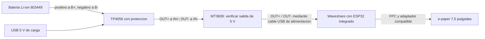

# Alimentacion prevista

La ilustracion es funcional: las posiciones de los terminales no sustituyen las etiquetas reales.

Esquema para TP4056 **con proteccion** y terminales OUT separados. Si tu modulo solo tiene B+ y B-, este esquema no corresponde a esa variante.

- Conectar el panel y modificar conexiones solo sin alimentacion.
- No conectar simultaneamente el USB del PC y la salida del elevador a la placa.
- Desconectar el consumo del sistema durante la carga: el TP4056 basico no proporciona gestion independiente de carga y consumo.
- Comprobar 5 V estables antes de conectar la Waveshare; no usar el MT3608 que permanece en 3,7 V sin diagnosticarlo.
- El codigo 603449 no determina por si solo la capacidad o corriente de carga admisible: consultar la ficha real y ajustar el TP4056.
- Los terminales B- y OUT- de un TP4056 protegido no deben puentearse, porque se puede anular la proteccion.

Este documento describe el montaje previsto, no una prueba electrica completada.
