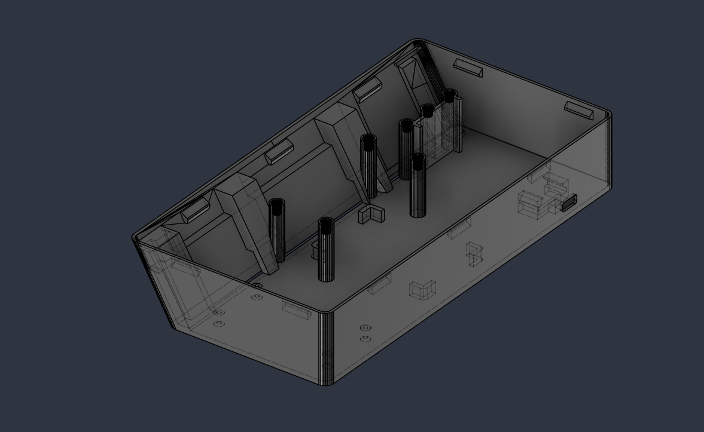
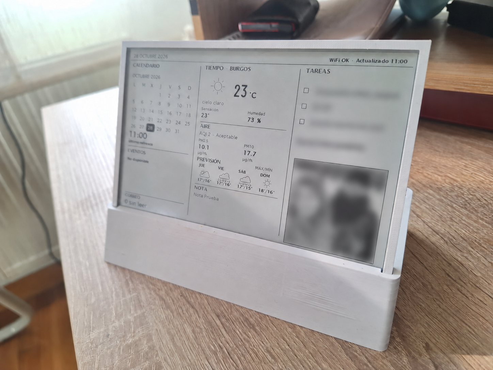

# Soporte impreso en 3D

Modelos STL y fotografias aportados para el soporte del dashboard e-paper de
7,5 pulgadas. Se conservan los nombres originales de los archivos.

## Archivos para descargar

| Modelo | Archivo |
| --- | --- |
| E_paper_support | [E_paper_support.stl](E_paper_support.stl) |
| Base_1 | [Base_1.stl](Base_1.stl) |
| Dashboard base | [Dashboard base.stl](Dashboard%20base.stl) |

Los tres archivos se incluyen tal como se recibieron. No se han modificado
las mallas ni generado G-code. No se incluyen fuentes CAD editables.
La correspondencia de cada base y sus posibles variantes queda pendiente
de documentar; no se presupone que deban imprimirse los tres archivos juntos.

## Vista digital

## Resultado real

La fotografia muestra el resultado aportado por el autor, con zonas de datos
personales ya desenfocadas en la imagen recibida. No se han reconstruido ni
editado esas zonas.

## Antes de imprimir

Comprueba en tu laminador la escala, las dimensiones y la compatibilidad con
tu pantalla y electronica. Los STL no declaran una unidad de medida de forma
estandar. No se han especificado material, orientacion, altura de capa,
relleno, soportes ni tornilleria; no se incluyen ajustes de impresion sin
verificar.
